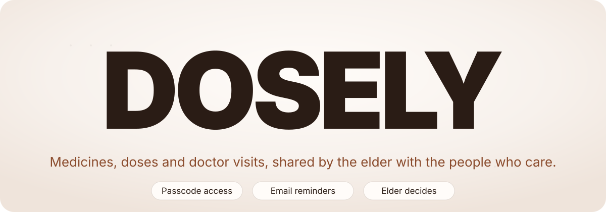
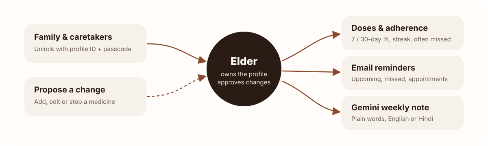

<p align="center">
  
</p>

<p align="center">
  <b>Elderly care and medication management, shared by the elder with the people who care.</b><br>
  Built for <b>PromptWars × Catalyst</b> · Google for Developers · Build with AI
</p>

<p align="center">
  <a href="https://github.com/Mukul07777/Dosely/actions/workflows/ci.yml"></a>
  
  
  
  
  
</p>

---

## Why Dosely

Looking after an elder's medicines is a team job: a son in another city, a daughter who buys the strips, a
caretaker at home, a doctor every few weeks. Today it lives in a noisy chat group, and the elder is the last to
be asked. Dosely gives them **one shared health profile, opened with a passcode, where the elder stays in charge.**

<p align="center"></p>

## Chosen vertical

**Elderly Care & Medication Management.** The persona is an elder (65+) who takes several daily medicines, and the
people around them: family members who may live in another city, and a caretaker at home. The elder owns the
profile; everyone else helps with their consent.

## Approach and logic

Dosely is not a fixed reminder clock. Every decision depends on **who** is acting, **what** the elder allowed and
**where** the dose or visit stands in time.

| Situation (context) | Decision |
|---|---|
| Someone unlocks the profile | Passcode checked against a PBKDF2 hash. 5 wrong tries lock it for 15 min and the elder is emailed. Each person gets their own revocable session. |
| A family member or caretaker changes a medicine | If the elder turned on *ask me first*, the change is **queued as pending**, not applied, until the elder approves. View-only members are refused. The elder is emailed either way. |
| The elder changes their own medicine | Applied at once: the elder is in charge of their own care. |
| Dose time is 15 min away | State `upcoming` → email the **elder and caretakers** (the people who give the dose). |
| Dose time has passed, not ticked | State `due`, shown in amber on the page. |
| Still not ticked 1 h later | State `missed` → email the **whole circle**, with "never double the dose" advice. |
| The dose is over 6 h old (e.g. server was down) | **No email**: a stale alarm helps nobody. |
| A daily routine (BP check, walk) is due and not ticked | One email to the **elder and caretakers**, within the hour after its time. Never a late nag after that. |
| A view-only member tries to change anything | Refused (403) for medicines, routines and appointments. They may still **tick** a dose or routine: recording what happened is not changing the plan. |
| Nobody on a profile has an email address | The profile is skipped before its schedule is read, and nothing is marked as sent, so reminders start the moment an address is added. |
| Appointment in 24 h, then 2 h | One email each to everyone; a visit added late gets only the nearer reminder; a moved visit is reminded again. |
| Weekly note | Gemini explains the computed numbers only, under rules that forbid suggesting, changing or stopping any medicine. Without a key, a rule-based note is used. |

Every reminder is recorded once (`circle_sent`), so retries and restarts never send duplicates.

## How it works

1. **The elder creates a profile** on `/circle`: name, email, a passcode, and whether changes need approval.
   Dosely returns a profile ID such as `KC-7HQ2PX` to share with family.
2. **Family and caretakers unlock it** with the ID, the passcode, their name, email and role.
3. **The circle manages the schedule together.** Medicines (morning, noon or night, food timing, as needed) live in
   the same tables the rest of the app uses, so reminders, the Care page and Dadi mode all agree.
4. **Daily routines** (check BP, morning walk, drink water) sit beside the medicines, each with a time and a tick.
5. **Doses are ticked** by the elder or a caretaker; adherence (7 and 30 days, streak, often-missed medicines) is
   computed from those ticks.
6. **A background job runs every minute** (`circle.run_reminders`), works out the state of each dose and routine
   and each appointment's window, and sends the emails described above.
7. **The elder sees everything**: pending changes to approve, who joined, and an activity log of every action.

Code: [`api/circle.py`](api/circle.py) (logic), [`api/routes/care_circle.py`](api/routes/care_circle.py) (API),
[`api/mailer.py`](api/mailer.py), [`api/gemini.py`](api/gemini.py), [`web/app/circle/page.tsx`](web/app/circle/page.tsx) (UI).

## Assumptions

- Dose times are fixed slots: **morning 08:00, noon 14:00, night 21:00**, in **India time** (`TZ=Asia/Kolkata`).
- A dose counts as **missed one hour** after its slot if nobody ticked it. Doses and routines cannot be ticked for a future day.
- Ticking a dose is trusted: Dosely records that it was taken, it cannot verify it.
- Medicines come from a doctor's prescription; Dosely never suggests, changes or doses a medicine.
- Email is the reminder channel the brief asks for; WhatsApp and Telegram are optional extras.
- One server instance (SQLite). For lasting data on Cloud Run, mount a storage volume (see the deploy guide).

## Features

| | |
|---|---|
| **Passcode-based access** | The elder creates a profile (e.g. `KC-7HQ2PX`) and a passcode. Family and caretakers unlock it with their name and email, and each gets a personal, revocable session. |
| **The elder decides** | With *ask me first* on, medicine changes by others wait for the elder's approval. The elder is emailed about every change and new member, and can make anyone view-only or remove them. |
| **Medication schedules** | Add, edit or stop medicines: morning, noon or night, before or after food, as needed. Anyone in the circle can tick a dose. |
| **Daily healthcare routines** | BP check, walk, sugar test, water: each with a time, a tick, and an email when it is due. |
| **Adherence tracking** | 7- and 30-day adherence, a streak of full days, and which medicines are often missed. |
| **Doctor appointments** | Add and manage visits, with one tap to add each to **Google Calendar**. |
| **Email reminders** | Upcoming dose (15 min before), missed dose (1 h late, to the whole circle), appointments (24 h and 2 h before). Each is sent once. |
| **Gemini weekly note** | **Google Gemini** turns the numbers into a warm note in English or Hindi. It never suggests changing a medicine. |
| **Safer medicines** | Every strip can be checked against India's CDSCO drug alerts (7,920 real alerts), so a failed batch never reaches the next dose. |

## Built with Google

- **Gemini API**: the plain-language weekly care note (`api/gemini.py`).
- **Gmail SMTP**: email reminders (`api/mailer.py`; Resend also supported).
- **Google Calendar**: "add to calendar" link on every appointment.
- **Cloud Run**: one container serves the site and the API ([deploy guide](docs/setup/CLOUD_RUN.md)).

## Quick start

```bash
# API (Python 3.12)
cd api && python -m venv .venv && .venv/Scripts/pip install -r requirements.txt   # macOS/Linux: .venv/bin/pip
.venv/Scripts/uvicorn main:app --port 8000

# Web (Node 20+), in a second terminal
cd web && npm install && npm run dev
```

Open <http://localhost:3000/circle>. Copy `.env.example` to `.env` and add your keys; without them, emails are
recorded in an outbox and the weekly note uses built-in text, so everything still runs.

| Variable | Purpose |
|---|---|
| `GEMINI_API_KEY` | Gemini weekly note ([get a key](https://aistudio.google.com/apikey)) |
| `SMTP_HOST`, `SMTP_USER`, `SMTP_PASSWORD` | Gmail: `smtp.gmail.com` and an [app password](https://myaccount.google.com/apppasswords) |
| `EMAIL_FROM` | Sender shown on reminder emails |
| `KINCARE_DATA_KEY` | Encrypts health data at rest |

## Deploy to Cloud Run

```bash
gcloud run deploy dosely --source . --region asia-south1 --allow-unauthenticated \
  --memory 2Gi --min-instances 1 --no-cpu-throttling
```

Keys go in Secret Manager, never in the image. Full steps: [docs/setup/CLOUD_RUN.md](docs/setup/CLOUD_RUN.md).

## Security and accessibility

- Passcodes hashed with PBKDF2 (200k rounds), weak codes refused, lockout after 5 wrong tries with an email to the elder.
- Session tokens stored hashed; health data encrypted at rest; CSRF guard, strict security headers, rate limits.
- Every name and note is stripped of control characters before it is stored or put in an email subject, so nobody can
  forge email headers; SQL is parameterised throughout; one profile can never read or change another's records.
- View-only members are refused every schedule change on the server, not just hidden buttons.
- Large type, 48 px touch targets, labelled forms, screen-reader status messages, Hindi and English.

## Efficiency

- Adherence over 30 days reads every tick in **one query** (a test asserts it), not one per dose.
- The reminder job does one members lookup per profile and skips profiles with nobody to email.
- Reminders are de-duplicated by a primary key (`circle_sent`), so a retry costs one failed insert, not an email.
- The site talks to the API through its own origin, so there are no CORS preflights.

## Testing

```bash
cd api && .venv/Scripts/python -m pytest        # 240 tests: care circle rules, security, reminders, matching
cd web && npm test && npx tsc --noEmit && npx eslint .   # 16 tests: display rules, passcode token handling
```

## Project structure

```
api/        FastAPI: care circle, reminders, Gemini, email, drug-alert matching
web/        Next.js 15 site (landing, /circle, care, family, Dadi mode)
docs/       setup guides, security notes
Dockerfile  Cloud Run image (site + API in one container)
```

## Author

Built by **Mukul**.
